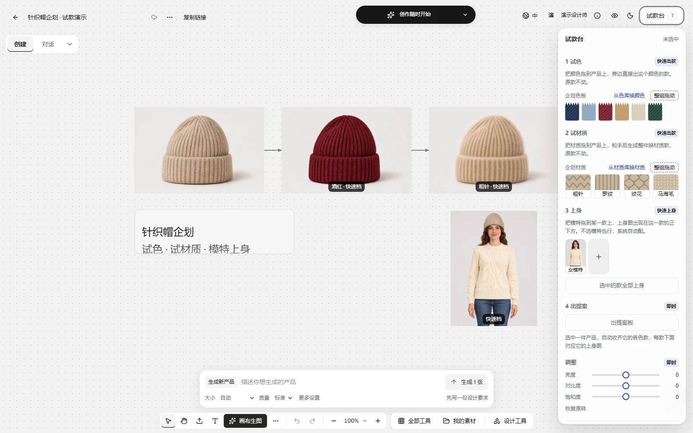
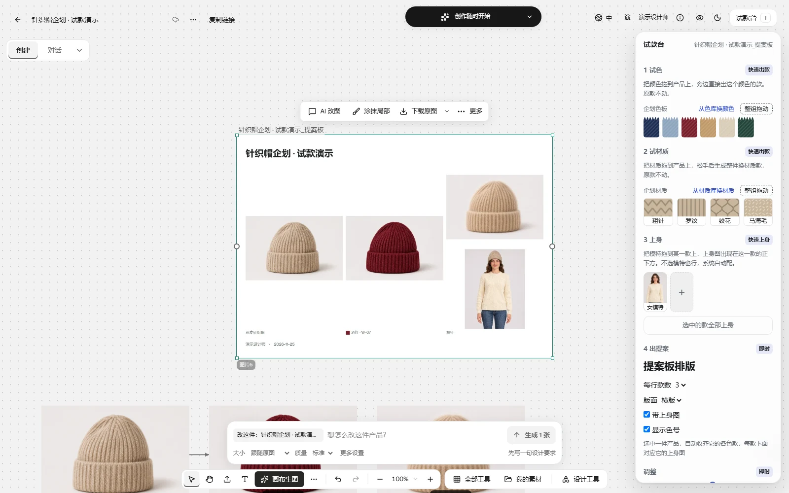
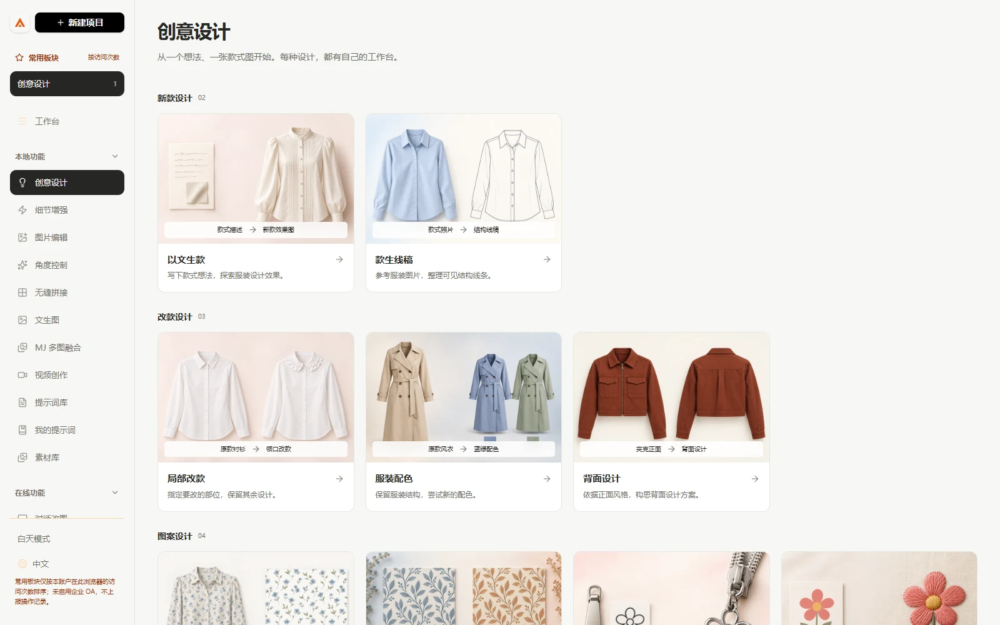

# 无线画布 · Vincent's Canvas

面向服装、配饰与图案设计的 AI 创作工作台。把参考图、设计要求与各版结果放在一张无限画布上，从试款到提案都能回看原图和设计过程。



## 核心功能

- **自由画布** · 组织多张参考图、生成设置和结果，用节点连线、对话改图和版本对比跟踪迭代。
- **试款台** · 把色卡、材质或模特拖到产品图上，生成独立的换色款、换材质款或上身图。可以整组试款，也可替换企划色卡、上传个人面料和模特。
- **提案板** · 将试款和对应的上身图排在一页，支持每行 2 到 6 款、横竖版及色号和上身图的显示设置。
- **创意设计** · 从文生款、局部改款、服装配色、花型提取等场景开始，也可用图案定位和花型循环工具。可选模型的生图、改图和批处理支持 Qwen Image 3.0。



## Windows 快速开始

安装 Git、Bun 和 [兼容的 Node.js](docs/content/docs/backend/local-development.mdx#模型-https-运行要求)。克隆、安装依赖并构建后，启动本机试用。

```powershell
git clone https://github.com/Jizhidemu52/Vincent-s-Canvas.git
cd Vincent-s-Canvas
bun install --cwd web --frozen-lockfile
bun install --cwd server --frozen-lockfile
.\Build-LAN.ps1
.\Start-Local.bat
```

在浏览器打开 `http://127.0.0.1:5188/canvas`。

### Windows 本地与局域网配置

模型凭据、试款开关、局域网、企业 OA 与更新备份见 [Windows 部署说明](README-本地部署.md)。

## 文档

- [操作手册](docs/manual/user-guide.md) · [完整功能](docs/content/docs/overview/features.mdx) · [文档索引](docs/index.md)
- [安装与部署](docs/manual/installation-guide.md) · [Linux](docs/manual/linux-deployment.md) · [宝塔离线安装](docs/manual/baota-offline-installation.md)
- [开发与测试](docs/content/docs/backend/local-development.mdx) · [版本记录](CHANGELOG.md)



截图来自隔离演示环境，使用演示素材。

## 许可

本项目可授权的原创部分采用 [PolyForm Noncommercial 1.0.0](LICENSE)。超出许可范围的商业使用须另行取得[书面授权](COMMERCIAL_USE.md)。第三方组件和素材遵循[各自许可](THIRD_PARTY_NOTICES.md)。
