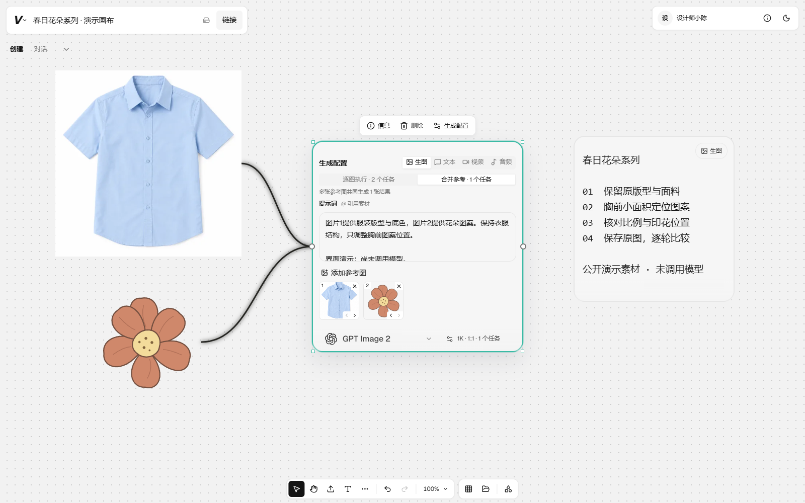
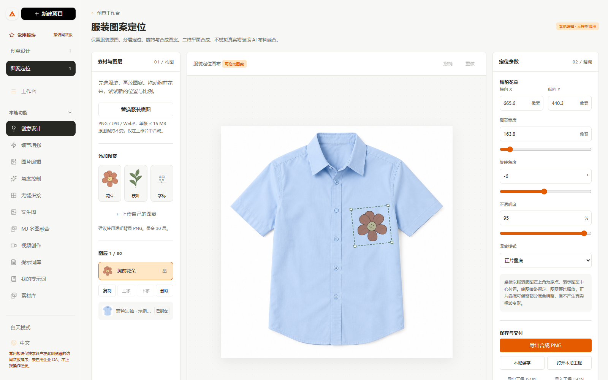

# 无线画布 · Vincent's Canvas

面向服装、配饰与图案设计的 AI 创作工作台。把参考图、设计要求、生成任务与各版结果放在同一张无限画布上，从整理灵感到逐轮改稿，都能看清输入、过程与来源。

> **源码可见 · 非商业使用。许可允许的用途与例外见 LICENSE。**
>
> 本项目权利人有权许可的原创部分采用 [PolyForm Noncommercial 1.0.0](LICENSE)。第三方组件与素材保留各自许可，见 [第三方声明](THIRD_PARTY_NOTICES.md)。不属于许可证允许用途的商业使用须另行取得[书面授权](COMMERCIAL_USE.md)，企业内部生产使用不因自行部署而自动获得免费商用许可。部署文档是技术说明，不构成使用授权。

[操作手册](docs/manual/user-guide.md) · [完整功能介绍](docs/content/docs/overview/features.mdx) · [安装部署](docs/manual/installation-guide.md) · [商业使用](COMMERCIAL_USE.md)

## 一张画布，串起整轮设计



参考素材与生成配置通过连线组织，原图和结果并排保留，适合整理一款产品的多个设计方向。

- **多图参考**：上传、粘贴或选中画布图片，调整引用顺序，用编号与 `@` 引用说明每张图的用途。
- **逐图执行与共享配置**：多张原图可共用提示词、模型和参数，每张独立处理；也可切换为合并参考，让多张图共同生成一个结果。公共参考与各任务主图区分，不把所有图片混成一个任务。
- **批量独立任务**：每项图片任务固定输出一张，单独保留输入、状态与结果；服务端控制并发，停止派发不会把已受理任务当作从未执行。
- **对话改图**：在画布或独立对话中讨论要求、读取参考、继续修改已有图片；对话理解与图片生成分别由服务端配置的模型承担。
- **对比与回溯**：滑块、并排、叠加和差异图辅助检查改稿；结合来源快照、输入归档、撤销重做与画布备份保留过程，生成结果与原图分开保存。

## 服装创意与设计工作台


按新款、改款和图案需求进入专用页面，用结构化字段表达款式、颜色、工艺与需要保留的细节。

支持以文生款、款生线稿、局部改款、服装配色、背面设计、花型提取、图案配色、辅料设计和图案工艺等创意场景；也提供图片、视频、音频、素材与提示词管理入口。



图案定位与花型循环使用本地二维编辑；系列配方整理参考、配色与约束，再显式提交图片编辑任务。

手动裁剪、标注、拆图、尺寸调整与本地换色无需模型调用。AI 结果用于概念探索，不等同于纸样、生产工艺稿或实物色准；选区内结构、材质和接缝仍需人工核对。

> 本页截图使用当前真实页面、隔离演示数据与公开演示素材，仅说明界面和工作流程，不是付费出图质量证明，也不展示用户工作资料。

## 模型与任务由服务端管理

- Provider 地址、模型凭据、板块绑定、开关及并发限制由服务端管理；设计师不需要在浏览器填写外部 API Key。
- 正式后端可启用独立账号密码、管理员权限与可选积分，不必接入公司 OA；免登录试用不提供同等身份隔离。
- 图片、视频与文字使用各自的服务配置，参数按模型实际接入能力展示。统一对话模型由管理员指定，失效时明确报错，不静默换用其他模型。
- 已受理任务保留请求编号与任务编号。可恢复的异步任务查询原上游 ID；提交或结果状态不明时保留任务，不自动重发付费请求。
- 启用内部积分时按任务快照结算。正式后端仅允许确认未提交的任务取消并释放积分；已提交或结果不明的任务不会因本地取消而自动退款。

外部模型可能收费，也可能受余额、权限、限流和上游状态影响。接口接入或离线测试通过，不代表每个模型实时可用、每张结果都符合视觉要求。

## 保存在哪里

- **本机免登录试用**：画布保存在当前浏览器；生成任务与服务端素材另由本机服务保存。Windows 试用使用共用身份，不提供员工隔离。
- **企业 OA 模式**：正确配置并通过身份验证后，画布与原始媒体按员工同步到服务端；须确认同步完成，目标环境的权限、恢复与网络限制仍需验收。
- **浏览器内的内容**：独立聊天、创意草稿、个人模板和设计工作台工程仍有本地保存边界，不承诺全部云同步。换设备、清理网站数据或升级前，请导出重要内容并备份服务端数据。

画布不是实时多人协同编辑器。模型密钥、`.env`、数据库、私人素材、测试输出与构建产物不要上传 GitHub；正式入口还需要 HTTPS、可信身份与网关访问控制。

## Windows 快速开始

先确认用途符合上述许可。准备 Git、Bun 和兼容的 Node.js；版本要求见[本地开发说明](docs/content/docs/backend/local-development.mdx)。严格蒙版与服务端图片格式处理另需 FFmpeg / ffprobe。

```powershell
git clone https://github.com/Jizhidemu52/Vincent-s-Canvas.git
cd Vincent-s-Canvas
cd web
bun install --frozen-lockfile
cd ..\server
bun install --frozen-lockfile
cd ..
.\Build-LAN.ps1
```

按下方“Windows 本地与局域网配置”配置 `server/.env`。仅在本机使用时运行：

```powershell
.\Start-Local.bat
```

使用启动脚本实际显示的地址。默认免登录试用不等于企业隔离环境，仅向受信网络开放；不要把本地可访问视为生产部署完成。更新前先备份，已有服务按部署手册安排重启，不强制覆盖本地修改。

## Windows 本地与局域网配置

### 凭据与首次构建

Windows 10 / 11 上的运行电脑需能访问模型服务商，并安装 Bun、兼容的 Node.js，以及媒体处理所需的 FFmpeg / ffprobe。第一次按上方命令安装锁定依赖和构建；后续也可双击 `Build-LAN.bat`，成品生成在 `web/dist`。完整前端包含后台代码，不代表 Windows 单机服务开放正式管理员权限。

若 `server/.env` 不存在，复制 `server/.env.example` 为该文件；不要覆盖已有配置。按实际使用的平台填写服务端凭据。例如 OpenToken：

```ini
OPENTOKEN_BASE_URL=https://cn2.gw.opentoken.io/v1
OPENTOKEN_API_KEY=在运行电脑填入自己的真实Key
```

模型 Key 只保存在运行电脑的 `server/.env`，不要发送到群聊、前端或 GitHub。设计师列表显示已启用且可用的模型；已接入的 APIMart 与 OpenToken 图片型号保留明确展示名称及独立配置身份，不把未配置服务当作可用。所有使用者消耗运行电脑的模型额度，关闭内部积分不代表外部调用免费。

### 选择启动方式

| 用途 | 入口 | 访问与存储边界 |
| --- | --- | --- |
| 本机成品试用 | `Start-Local.bat` | 仅监听 `127.0.0.1:5188`，不改防火墙；服务端使用已有 `server/.data/local-demo.sqlite` |
| 受信局域网试用 | `Start-LAN.bat` | 使用脚本实际打印的实体网卡地址；同事必须在允许的局域网内，运行电脑保持开机 |
| 企业 OA 试点 | `Start-LAN.ps1 -CompanyOa` | 管理员先配置可信 OA 接口；从“企业微信 → 公司 OA → 画布”进入，不新增画布扫码步骤 |
| 正式 PostgreSQL / Redis / S3 部署 | `docker compose up -d --build` | 先按[生产部署手册](docs/manual/production-deployment.md)准备配置、迁移、HTTPS、网络限制与备份 |

`Start-LAN` 会检查构建与部署模式，选择已连接的实体以太网或 Wi-Fi 网卡并排除 VPN / WSL 虚拟网卡，健康检查通过后才显示就绪；重复启动复用现有实例，不自动重启或切换试用／企业模式。若需要防火墙管理员权限，先确认使用受信网络；脚本限制到所选网卡、本机地址和本地子网，并不代表正式公司白名单已验收。日志在 `server/.data/lan-server.out.log` 和 `lan-server.err.log`。

默认试用无需登录，使用共用创作身份，不保证员工隔离；试用画布保存在浏览器，任务和生成素材保存在 SQLite。企业 OA 模式须校验员工身份，按员工保存画布、原图、素材与任务；旧共用数据不会自动迁入个人账号。独立聊天、创意草稿和个人模板仍有浏览器保存边界。正式后端的独立密码／企业微信和积分功能不等于上述 Windows 演示入口，详见[身份与存储说明](docs/content/docs/backend/backend-database.mdx)。

### 更新与备份

更新前导出重要浏览器内容，并备份 `server/.env`、`server/.data`。SQLite 备份需先停服后复制整个数据目录，不能运行中只拷贝 `.sqlite` 主文件；正式 PostgreSQL 与对象存储要联合备份。

```powershell
git pull --ff-only origin main
cd web
bun install --frozen-lockfile
cd ..\server
bun install --frozen-lockfile
cd ..
.\Build-LAN.ps1
```

不要强制覆盖本地改动。服务端或 Key 变更后，等待当前生成结束，安排停止本项目旧服务，再按原模式启动；重复双击局域网脚本不会重启旧实例。前端刷新不代替服务端更新。中断的任务不自动重新提交付费生成；企业会话失效应从 OA 重新进入。

### 常见问题与安全边界

- **同事打不开**：确认同一受信局域网、使用脚本打印的地址而不是 `127.0.0.1` 或旧 IP，检查运行电脑休眠和受控防火墙规则。
- **网页能开但生成失败**：检查相应服务端 Key、模型配置、余额和上游网络；修改凭据后重启本项目服务。界面可访问不等于上游可用。
- **等待很久**：先比较运行电脑与同事电脑的同规格任务和网络；生成耗时可能来自上游模型、额度、排队或 Wi-Fi，不能只凭页面等待推断故障。
- **正式公司入口**：由 IT 确认服务器、HTTPS 域名、出口 IP / 网段和可信身份接入，限制网页、API、媒体及后端端口，并实测公司外拒绝访问。局域网 HTTP 仅用于受信试用；已下载或缓存的图片无法远程收回。
- 不上传未获授权的客户机密、个人信息或图片。企业画布离开前确认已同步；换设备前导出本地内容。部署技术说明不替代使用授权。

## 文档与项目结构

开发与部署入口分开使用，不会互相切换现有服务：

| 用途 | 入口 | 边界 |
| --- | --- | --- |
| 源码热更新 | 根目录 `bun install --frozen-lockfile` 后 `bun dev` | 本机 Vite `3000` + API `3100`，独立 `dev-local.sqlite`；仍可能调用真实收费模型 |
| 本机成品试用 | 构建后 `Start-Local.bat` | 仅 `127.0.0.1:5188`，现有本机数据不变 |
| 局域网 / 正式环境 | `Start-LAN.bat` / `docker compose up -d --build` | 按对应部署文档配置身份、存储、网络与备份 |

首次开发还需在 `web/`、`server/` 分别执行 `bun install --frozen-lockfile`。根目录 `bun check` 执行高置信度 lint、两端类型检查、前端正式构建（含包体预算）与测试，会重建 `web/dist`；正在使用成品服务时应安排维护窗口。通过 `DEV_API_PORT` / `DEV_WEB_PORT` 可更换开发端口，开发启动器不会杀掉已有服务。

`bun run format <文件路径>` / `bun run format:check <文件路径>` 分别定向格式化或检查前后端文件；不要求为局部修改重排整个仓库。

- 使用：[操作手册](docs/manual/user-guide.md) · [功能介绍](docs/content/docs/overview/features.mdx) · [文档导航](docs/index.md)
- 部署：[Windows](README-本地部署.md) · [Linux](docs/manual/linux-deployment.md) · [宝塔离线安装](docs/manual/baota-offline-installation.md) · [安装与更新](docs/manual/installation-guide.md)
- 维护：[本地开发](docs/content/docs/backend/local-development.mdx) · [当前待验收项](docs/content/docs/progress/pending-test.mdx) · [版本记录](CHANGELOG.md)

```text
web/       React + TypeScript + Vite 前端与测试
server/    Bun API、Worker、模型适配、持久化与测试
shared/    前后端共用的能力与模型配置
ops/       部署预检、离线包、备份恢复与压测
docs/      使用、部署、开发与验收文档
labs/      独立实验与第三方模块验证，不接入正式画布运行时
```

第三方内容的许可、来源与使用限制以 [THIRD_PARTY_NOTICES.md](THIRD_PARTY_NOTICES.md) 及其原始声明为准；本项目的商业授权不会自动替代第三方授权。
