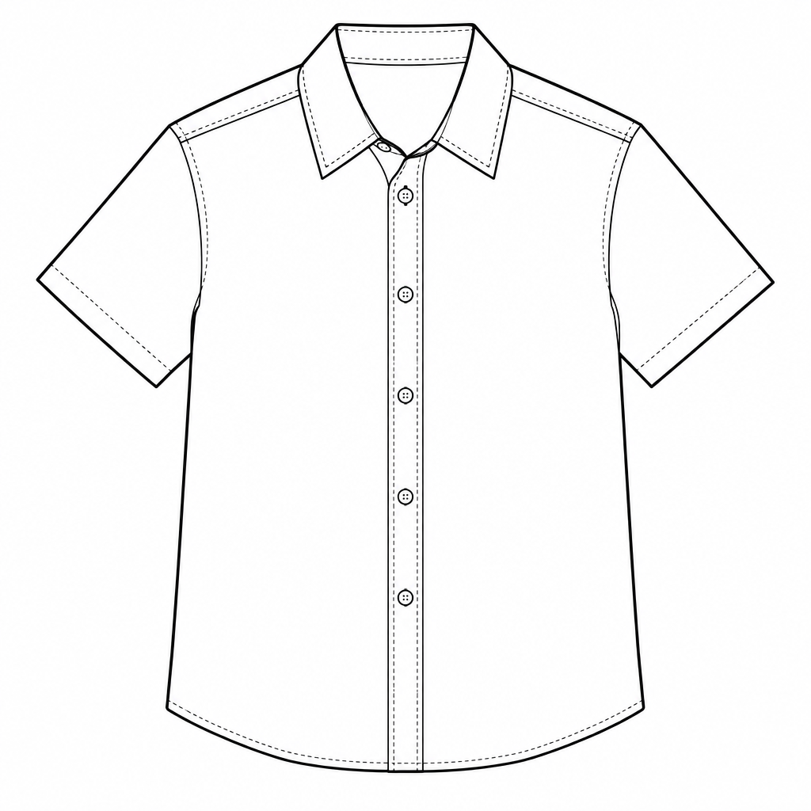

# v0.5.6 修复与真实出图验证

代码和证据仅提交 GitHub；没有更新宝塔、切换线上服务、充值或修改线上配方。原始规则文档保持不变。测试使用隔离的本地 SQLite 克隆与既有合成素材；候选配方只在测试克隆中激活，结束后已核对恢复原版本。

## 修复了什么

- **透明参数缺失**：花型提取／图案配色现在从已授权主图读真实 alpha，生成原生 `background=transparent` 和 PNG 参数。选择白底或使用不透明主图时清除冲突设置；不支持的渠道、透明 JPEG 冲突明确报错，不静默跨模型。
- **“透明成功”误判**：返回结果实际全不透明时暂停，保留渠道原件；不以 PNG 后缀当作透明，不自动抠图或重复生图。检测只判断是否存在透明像素，不能自动识别光晕或判断保真质量。
- **规则自身诱导变形**：导入纠偏覆盖原规则的默认补全、强制微距和浅景深；线稿强调完整部件与半遮挡部件分开计数，配色不重新设计结构。更新代码不会自动替换已启用配方，需显式导入新版本并由管理员选择启用。
- **指定印字冲突**：识别单／双引号、常见中文引号及结构化文字字段；必须逐字保留，笼统禁字项限定为无关文字。保留不相关文字、水印及其他明确负向限制。

## 实测结果

完整原图对照：[本地交互画廊](./gallery.html)（下载后用浏览器打开）；可在 GitHub 直接查看下方 PNG。机器可核对的输入、实际提示词、参数、版本哈希、状态和用量见 [report.json](./report.json)，文件完整性见 [evidence-manifest.json](./evidence-manifest.json)。18 张原始 PNG 未重新编码或修图。

| 范围 | 结果 | 判断 |
| --- | --- | --- |
| 工艺构图 2 张 | 2 PASS | 叶片和花形完整入镜，原来裁边的问题在本组改善 |
| 花型提取 5 张 | 2 PASS、3 REDO | 白底叶片、横向纹样带通过；几何单元仍被重构，透明花形仍有光晕／细节丢失 |
| 款生线稿 4 张 | 3 PASS、1 MINOR_FIX | 五颗完整纽扣加领口半遮挡纽扣保留；一次重复结果领尖和遮挡轻微漂移 |
| 透明图案配色 2 张 | 2 REDO | alpha 已有，光晕和细节漂移未解决 |
| Flare／Sunburst 原生透明开关 4 张 | 2 CONTROL、2 REDO | 同一实际提示词：关闭参数全不透明，开启后有真实透明，但视觉边缘仍不合格 |
| 指定印字 1 张 | 1 MINOR_FIX | `SUMMER 2026` 正确、五颗纽扣和口袋保留，但底色新增渐变 |

合计 **7 PASS、2 MINOR_FIX、7 REDO、2 CONTROL**。PASS 是本组需求的人工目视通过，不代表像素一致、生产可用或长期成功率。没有控制模型随机种子；重复线稿只有两组，不足以估算稳定性。历史失败图用于回看，未为凑对照重复付费生成旧结果。

代表结果：

| 工艺完整构图：通过 | 线稿纽扣／遮挡：通过 | 透明边缘：仍需重做 |
| --- | --- | --- |
|  |  |  |

原生透明开启的 6 张结果存在 alpha，且主体最不透明值仍只有 254/255，没有完全不透明像素；这说明“有透明度”远不等于合格的干净透明底。追加无光晕／实心要求、改用 Sunburst 后仍失败。本次没有把原图 alpha 硬套到变形结果，也没有用后处理掩盖问题。要求保真换色时，已有的本地精确换色功能仍更适合不允许结构变化的平面图案。

## 调用和异常

- 21 条用例记录，20 次图片提交尝试，取得 18 张结果。OpenToken 的 2 次请求返回 `insufficient enterprise balance`，没有图片，不能评价其透明效果；未充值或自动改走其他通道。
- 15 次编译 POST，包含 2 条缓存别名；13 条根编译记录中 12 成功、1 失败。已记录根请求用量为 24,917 输入 Token、3,897 输出 Token；失败记录用量未知，不能当作 0。
- `repair-v1/pattern-extract-03-new` 原执行日志标记 uncertain，之后从本地持久化记录确认是编译失败且未提交图片；公开报告同时保留 recordedStatus 和 verifiedStatus，没有抹掉原状态。修改规则后的 `repair-v2` 是新的测试请求，结果仍因形状漂移判为 REDO。
- 两张图片首次下载中断，使用原任务恢复下载；没有第二次生成提交。供应商真实费用及是否计费未知，`actualProviderTotalCost=null`，不使用站内配置金额推算账单。

## 验证与使用边界

最终服务端针对性回归 **128 项通过、0 失败**（9 个文件、597 条断言），覆盖透明检测、16 位 alpha、原件保留、暂停不重发、白底优先级、透明／不透明主图、多参考主图、错误冒泡、指定印字及导入不覆盖现有激活版本；前端请求回归 **35 项通过、0 失败**（3 个文件、166 条断言）。前后端构建、QA 脚本 TypeScript 检查和 714 个源码文件的 lint 通过。未声称本版重新跑全套业务测试、正式 PostgreSQL／Redis 并发验收或新一轮生产 UI 部署验收。

生图前的透明检查在提示词优化之后执行，不能宣传为所有付费调用前拦截；结构化场景支持不等于通用批量透明推断。无需图片变化的代码防护由离线测试验证，不为同一结论追加付费请求。

复现入口及隔离要求见 [QA 脚本说明](../../../../../server/scripts/README.prompt-quality.md)。发布的纠偏位于 `server/src/prompt-recipe-import.ts`；已有环境显式导入只保存新版本，不自动激活或覆盖管理员当前规则。此次 GitHub 交付不包含运行数据库、供应商凭据、员工素材或部署包。
